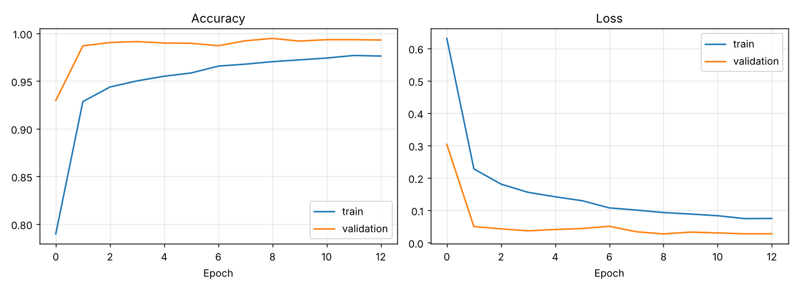
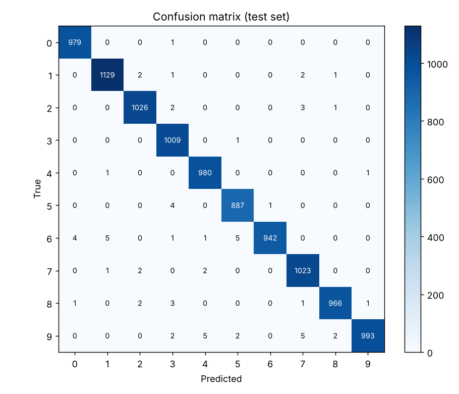
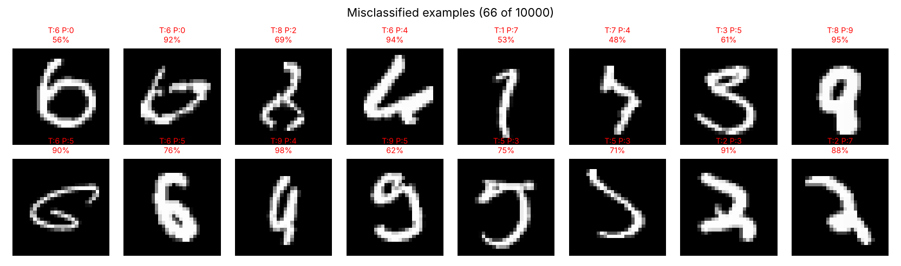
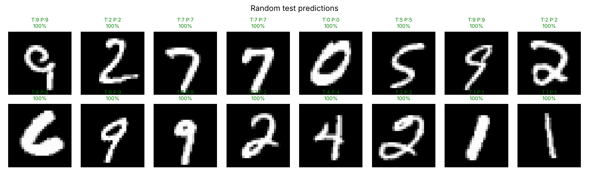

# Handwritten Digit Recognizer (CNN on MNIST)

A Convolutional Neural Network that recognises handwritten digits (0 to 9), trained on the MNIST dataset with TensorFlow/Keras. It also includes a script to classify a photo of your own handwriting.

## Results

| Metric | Value |
|---|---|
| **Test accuracy** | **99.34%** |
| Test loss | 0.0224 |
| Errors on the 10,000 image test set | 66 |
| Lowest per-digit F1 score | 0.991 (digit 9) |
| Parameters | 468k |
| Epochs trained | 13 (early stopping) |

The test set is the official MNIST test split of 10,000 images, which the model never sees during training or model selection.



Validation accuracy is higher than training accuracy because dropout and data augmentation are only active during training, which makes the training task deliberately harder.



### Where the model gets it wrong



Most of the 66 errors are digits that are genuinely ambiguous even to a human: a 6 with an open loop that looks like a 0, a 9 that looks like a 4, a 2 with a tail like a 7. This suggests the model is close to the practical ceiling for this data.



## Model architecture

```
Input 28x28x1
  Data augmentation (random rotation ±11°, shift 8%, zoom 8%; training only)
  Conv 3x3, 32 filters, BatchNorm, ReLU
  Conv 3x3, 32 filters, BatchNorm, ReLU
  MaxPool 2x2, Dropout 0.25
  Conv 3x3, 64 filters, BatchNorm, ReLU
  Conv 3x3, 64 filters, BatchNorm, ReLU
  MaxPool 2x2, Dropout 0.25
  Flatten, Dense 128 ReLU, Dropout 0.4
  Dense 10 Softmax
```

**Design choices:**
* **Two stacked 3x3 convolutions per block** see the same area as one 5x5 layer but with fewer parameters and an extra non-linearity.
* **Batch normalisation** stabilises training and allows a higher learning rate.
* **Dropout and augmentation** reduce overfitting. Rotation is kept small (±11°) because larger rotations start turning 6s into 9s.
* **Adam optimiser** with learning rate reduction on plateau and early stopping that restores the best weights.
* 10% of the training data is held out for validation.

## Predict your own handwriting

Write a digit on paper, take a photo, crop it roughly around the digit, then run:

```bash
python src/predict.py examples/digit_7.png
```

```
Prediction: 7  (confidence 100.0%)
Top 3: 7: 100.0%, 1: 0.0%, 2: 0.0%
```

The script converts the image to MNIST format: grayscale, inverted to white on black, cropped to the digit, scaled to 20x20 and centred in a 28x28 frame.

## Project structure

```
mnist-digit-recognizer/
├── data/                    # MNIST files (auto-downloaded on first run)
├── examples/digit_7.png     # sample image for predict.py
├── models/mnist_cnn.keras   # trained model
├── results/                 # plots and metrics.json
├── src/
│   ├── data.py              # downloads and parses the raw MNIST IDX files
│   ├── train.py             # builds, trains and evaluates the CNN
│   └── predict.py           # classifies your own digit image
└── requirements.txt
```

## How to run

```bash
pip install -r requirements.txt

# Train from scratch and regenerate all results (about 15 minutes on CPU)
python src/train.py --epochs 15

# Use the trained model on an image
python src/predict.py path/to/your_digit.png
```

## Tech stack

Python, TensorFlow/Keras, NumPy, scikit-learn, Matplotlib, Pillow

## Dataset

[MNIST](http://yann.lecun.com/exdb/mnist/): 60,000 training and 10,000 test images of handwritten digits, 28x28 grayscale.
